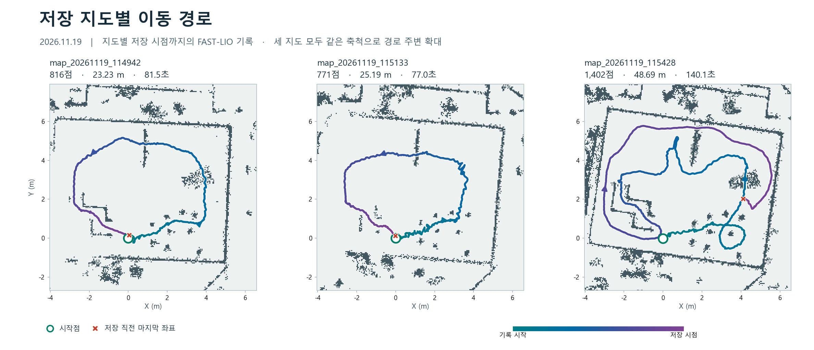

# 2026-11-19 경기장 지도와 경로

`maps/`에는 2026년 11월 19일 17시 17분경(한국 시간) 로봇에 있던 당일 지도와 경로 파일을 담았습니다. 2D 지도는 같은 이름의 YAML과 PGM을 함께 사용합니다. `right`와 `left`의 주행 좌표는 각각의 `.lane-path.json`에 있으며 길이 단위는 미터, 방향 단위는 라디안입니다.

| 지도 저장 이름 | 현재 3D 점군 | 원본과 픽셀이 동일한 현재 2D 지도 | 기록된 좌표 수 |
| --- | --- | --- | ---: |
| map_20261119_114942 | map_20261119_right.pcd | map_20261119_1.yaml | 816 |
| map_20261119_115133 | map_20261119_left.pcd | map_20261119_2.yaml | 771 |
| map_20261119_115428 | map_20261119_map.pcd | map_20261119_map_OG.yaml | 1,402 |

- **현재 지도**. `maps/`에 3D PCD 3개와 2D 지도 7종(1, 2, map_OG, map_space, map, right, left)이 있습니다. 2D right와 left는 편집한 공통 지도 위에 각자의 경로를 얹은 사본입니다. 원본 2D 1과 2는 서로 다른 지도입니다.
- **원래 저장 시점**. `original-saves/`에서 당시 이름으로 점군, 2D 지도, 지도 관계 정보와 매핑 경로 CSV를 열 수 있습니다. 점군은 지도 리비전으로, PGM은 SHA-256으로 이름 변경 전후 자료를 대조했습니다. 이 폴더의 YAML 3개는 대응하는 현재 YAML에서 PGM 이름만 당시 이름으로 복원했습니다. 원본 CSV의 좌표계는 `camera_init`이며 right·left의 공통 지도 변환값은 `maps/`의 해당 `.mapping-trajectory.json`에 있습니다.
- **배포된 경로**. `maps/`의 right와 left에 공통 지도 좌표계로 변환한 기록 경로 CSV 및 JSON, 화면 표시 경로, 주행용 경로가 있습니다. 당시 로봇의 주행 좌표는 right 80개, left 73개입니다. `spatial-routes/`에는 같은 날 등록된 두 경로의 리비전과 현재 리비전을 가리키는 파일이 있습니다.
- **경로의 다른 버전**. `route-versions/dense/`는 원래 밀도의 주행 경로와 지도 정합 결과입니다. `left_right_25cm/`는 로봇의 주행 경로 파일과 바이트가 같은 25cm 샘플 버전입니다. `left_right_25cm_course_fixed/`는 별도로 보존한 코스 보정 버전입니다.
- **수집 세션**. `session/capture.sqlite3`는 당일 매핑 기록기의 일관된 SQLite 스냅샷입니다. `poses`에 좌표 4,242개가 있고 `saves`에 지도 저장 3회가 기록돼 있습니다. 각 CSV는 해당 매핑 시작부터 그 지도의 저장 요청 시각까지의 좌표를 담습니다.

`SHA256SUMS`에는 이 폴더의 파일별 SHA-256이 들어 있습니다. 이 폴더에서 `sha256sum -c SHA256SUMS`로 내려받은 자료를 확인할 수 있습니다. `robot-SHA256SUMS`는 로봇에서 계산한 체크섬입니다.
