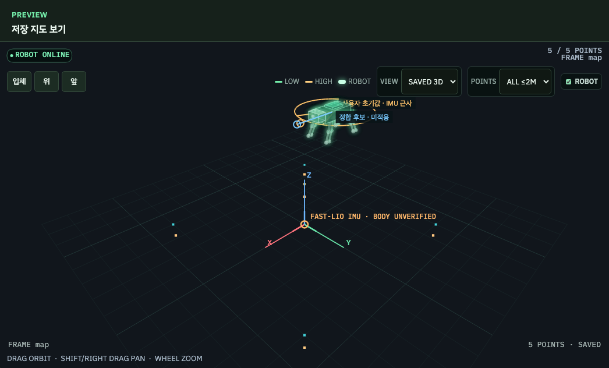
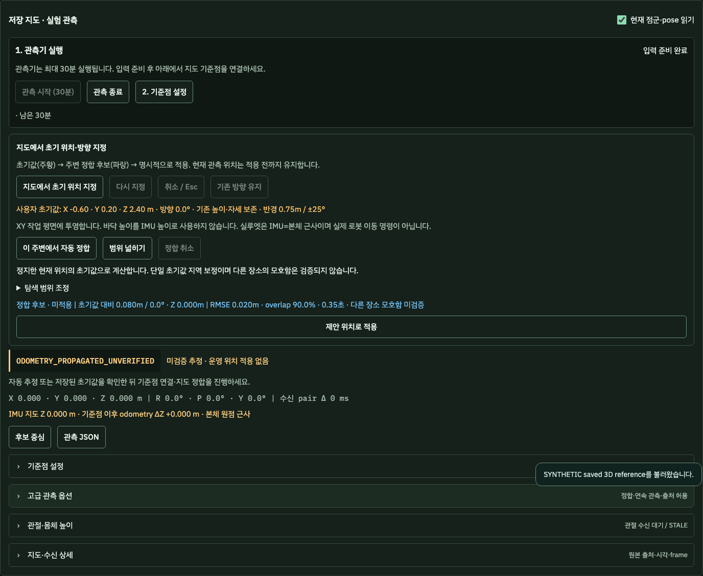

# I1 — 지도 클릭 초기값과 지역 정합

작성: 2026-10-27 KST. 독립 개발 채팅의 구현·검증 인계다.

**지도 클릭/방향 → 실제 seed 기반 지역 ICP → 후보 비교 → 명시적 관측 기준점 적용을 구현했다.**
배포·서비스 시작/정지·로봇 이동은 수행하지 않았다. 실장비 정지 정합은 `NOT_RUN`이다.

## 소스와 기존 작업 보존

| 항목 | 값 |
| --- | --- |
| 검토 브랜치 | `review/20261026-i1-map-seed` |
| 실제 검사한 구현 SHA | `f7c41d189a5f1766502b703bf72ae833a1f9051c` |
| 최종 기준 main | `a79dc18b50a0cddee2056fe4748781cdca03aec9` |
| main의 실행 코드 기준 | `d6e3fe9675f31e436f5236b390e36e188934f473` |
| 기존 통합 branch HEAD | `7777f471654d6da0afd3580a870d80b7b0b3eb4d` |
| 구현 다음 commit | 이 문서·합성 화면만 추가. 실행 소스와 테스트는 위 구현 SHA와 동일 |

PR #3은 이미 병합됐다. 참고 SHA로 reset하지 않았다. 작업 중 추가된 `a79dc18`의
배포 문서 3개를 fast-forward로 반영했다. 독립 checkout에서만 편집했으며 원본
checkout의 `dashboard-polish.css`, `map_editor3d/editor.css` 사용자 변경을 보존했다.
L1의 연결 상실 이유·stale geometry 제거는 유지한다. source가 끊겨도 재사용 가능한
지도 prior 숫자는 보존하되 활성 관측과 계산 후보는 무효화하는 것이 이번 의도된 변경이다.
C4 개발 checkout/브랜치·기존 통합 브랜치를 수정하지 않았다.

## 사용법

1. Maps에서 저장 **3D 지도**를 고른다. 센서가 없어도 위치 초안은 지정할 수 있다.
2. **지도에서 초기 위치 지정**을 누른다. 기존 화면이 top view로 바뀐다.
3. 클릭 후 드래그로 방향을 정하거나, 첫 클릭은 위치·두 번째 클릭은 방향으로 사용한다.
   짧은 클릭은 방향 대기로 남는다. 기존 draft가 있으면 **기존 방향 유지**도 가능하다.
4. 모델/방향 끝 핸들을 드래그하거나 **다시 지정**으로 수정한다. 휠 확대,
   Shift/우클릭 이동을 유지한다. **취소 / Esc**는 이전 초안·숫자·카메라를 복원한다.
5. 관측 입력이 준비된 **정지 상태**에서 **이 주변에서 자동 정합**을 누른다.
   이 동작이 오래된/오프라인 draft를 현재 IMU pose에 연결하는 명시적 확인이다.
6. 주황 초기값, 파란 후보, 기존 활성 관측 위치를 비교한다. 이동량·방향 변화·Z 변화,
   RMSE·overlap·계산 시간·다른 장소 모호함 미검증 표시를 확인한 뒤 **제안 위치로 적용**한다.
   적용 직전 서버에서 fresh proposal을 다시 읽어 현재 odometry로 전파한다.

숫자 입력은 **기준점 설정 → 고급 좌표 수정**에 있다. 클릭·숫자·기존 프리셋은 같은
초안과 동기화되며 프리셋 저장 API/형식은 유지한다. 편집·프리셋 불러오기·전역/지역
계산 시작만으로 기존 정상 관측 기준점을 지우지 않는다. 현재 위치 적용은 별도 동작이다.

후보가 없거나 품질 검사를 통과하지 못하면 초안과 활성 관측은 유지한다. `OUTSIDE_SEED_BOUNDS`
후보는 원래 좌표로 비교 표시하며 적용을 막는다. **범위 넓히기**는 초안의 범위만 변경하고
다시 계산해야 한다. **기준점 설정 → 지도 전체에서 찾기**는 명시적으로 고르는 기존 경로다.
자동 전역 fallback, 결과 clamp, 먼 후보 자동 적용은 없다.





위 화면은 Playwright의 합성 입력이다. 화면의 `.02m / 90% / .35초`는 UI fixture 값이며
아래 실제 수치 solver 측정값이나 실장비 정확도가 아니다. Z=2.4m는 바닥 클릭을 IMU
높이로 바꾸지 않는 것을 확인하기 위한 의도적인 테스트 값이다.

## 실제 정합 연결

새 엔진이나 새 start endpoint를 만들지 않았다.

```text
RobotScene3D.screenToMapPlane → MapSeedDraft
  → POST /api/v1/observations/global-jobs
      search_mode=seeded_local, input_kind=fastlio_imu, seed={...}
  → GlobalObservationCoordinator의 기존 단일 job slot/capture/context fence
  → RegistrationWorker.solve → solve_prepared → prepare_seed → register_se3
  → GET /global-jobs/{job_id}/anchor-proposal
  → 사용자 적용 → 기존 LiveMapObservation.setAnchor
```

`seed`는 revision, 6개 pose 값, `FASTLIO_IMU`, metres/degrees, map frame,
높이 출처, xy/yaw/z/tilt 범위, source epoch/subscription 계약을 전달한다.
알 수 없는 필드·비유한 값·잘못된 단위·범위·raw input 조합을 거부한다.
동일 request_id의 다른 seed/지도/범위는 충돌이다. 입력 거부 후에는 수정한 값으로 새
request_id를 사용한다. 네트워크 결과 미확인 시에는 같은 요청 재확인이 기존 ID/seed를 유지한다.

시각 ts는 클릭 시각이 아니라 **정합 요청 시 신선한 현재 pose에 seed를 확인한 시각**이다.
캡처 tc는 ts 이상인 점군과 정확히 같은 source stamp의 odometry가 있을 때만 사용한다.

```text
T_M_O_seed      = T_M_I(ts) × inverse(T_O_I(ts))
T_M_I_init(tc)  = T_M_O_seed × T_O_I(tc)
T_M_O_candidate = T_M_I_refined(tc) × inverse(T_O_I(tc))
T_M_I(now)      = T_M_O_candidate × T_O_I(now)
```

`/cloud_registered`는 이미 odometry 좌표다. 기존 `capture_registered_imu`에서
`inverse(T_O_I(tc))`를 한 번 적용해 IMU frame으로 재표현한다. LiDAR extrinsic을
다시 적용하지 않는다. source/지도 revision/job/draft revision/stamp 연결이 달라지면
이전 결과가 새 초안을 덮거나 적용되는 것을 차단한다. 센서 timestamp는 대체하지 않는다.

### 범위·평가·처리량

- 기본값: XY 반경 **0.75m**, yaw **±25°**, Z **±0.30m**, roll/pitch 각각 **±10°**.
  기존 correspondence gate 0.75m와 coarse-to-fine 경로를 활용한 UI 초기값이다.
  실측 안전 범위나 이 범위 전체의 수렴 보장이 아니다.
- 단일 초기값 coarse-to-fine SE3로 6개 변수를 보정한다. 최종 해와 캡처 시각 seed의
  XY norm/Z/yaw/roll·pitch 차이를 제한한다. yaw 차이는 ±180° 경계를 wrap한다.
  solver 내부의 매 반복을 hard constrain한 exhaustive 탐색은 아니다.
- target 반경 = `max(norm(scan point)) + hypot(xy_bound, z_bound) + 0.75m`.
  로봇 중심의 허용 반경만 남겨 관측 벽을 잘라내지 않는다. 정합 대상의 실제 스캔 범위를 포함한다.
- full cached registered query를 그대로 최종 평가한다. 추가 query downsample은 없다.
  입력은 이미 Dashboard 캐시 정책의 sampling을 포함할 수 있다. raw sensor archive가 아니다.
- 평가 범위는 `FULL_CAPTURE_AGAINST_PRIOR_REACHABLE_SCAN_FOOTPRINT`다.
  full-map/global score와 동일한 의미로 비교하지 않는다.
- 기존 품질 기준 유지: RMSE ≤0.05m, overlap ≥0.6, 수렴, 입력·matched geometry ≥0.002,
  최소 60점. 기존 provisional 0.10m 정책을 지역 초기화 성공으로 확대하지 않았다.
- 기존 수치 경로 한도: query 60–4,000점, 선택 target 60–100,000점.
  full-map snapshot의 기존 1,000,000점/32MiB 한도도 유지한다. 한도를 넘으면 명시적으로
  거부하고 몰래 sampling/quality 완화하지 않는다. 매우 큰 지도는 이 경로에서 지원되지 않을 수 있다.
- 기존 취소 가능한 job owner를 재사용한다. 수치 계산은 기존 별도 프로세스에서 하고
  취소 시 IPC 대기를 깨워 terminate/reap한다. 정리 전에는 동일 owner의 새 작업을 받지 않는다.
  0.6초 제한·TTL 완화·무제한 queue/thread를 추가하지 않았다.
- 단일 seed만 시험하므로 다른 장소의 모호함은 **미검증**이다. `hypotheses_tested=1`,
  `ambiguity_unresolved=true`를 보존한다. RMSE가 작아도 정답/절대 정확도라고 표시하지 않는다.

XY는 명시적인 작업 평면에 역투영한다. 기존 호환 prior의 Z/roll/pitch를 보존하며,
호환되는 현재 IMU 위치가 없으면 숫자/기본값을 **높이·자세 근사**로 표시한다.
바닥 Z를 IMU Z로 사용하지 않는다. 미리보기는 IMU=본체 가정의 근사 실루엣이고,
telemetry robot과 별도 레이어다. 본체 extrinsic 검증이나 물리 이동 명령으로 연결하지 않는다.

## 수치·회귀 검증

| 검사 | 결과 |
| --- | --- |
| Python 전체 unittest | 2,845 실행, 실패/오류 0, 14 SKIP (106.431초) |
| 신규 실제 수치/API 검사 | 9 PASS; 위 전체 검사에 포함 |
| JavaScript 전체 | 674 PASS, 0 SKIP |
| 관련 Playwright | 관측·전역 제안·history 34/34 PASS; 최종 renderer/fixture 조정 후 해당 2개 및 최종 1개 재검사 PASS |
| Ruff / mypy / JS syntax | PASS; mypy는 저장소 설정의 4개 source, JS 109 modules |
| tracked source credential scan / diff whitespace | PASS |
| 실제 장비에 이 기능 배포·정지 관측 | NOT_RUN |

로컬 Python 3.13 환경이다. 첫 전체 실행은 `cv2` 부재로 오류 11개였고, 임시 검사 폴더에
저장소 지정 OpenCV를 설치한 뒤 전체 재실행했다. 기존 venv/장비는 변경하지 않았다.
최종 SKIP 14개는 C4 replay의 `jsonschema` 부재 10개, 선택 SVG/rosbags 2개,
Linux `/proc` 전용 검사 2개다. 이를 기능 PASS로 포함하지 않는다.

신규 수치 테스트는 실제 격리 worker로 실행했다. 240점 3D 구조 두 곳을 14m/-9m 떨어뜨린
합성 지도에서 seed별로 해당 구역으로 수렴한다. XY/yaw 오차와 nonzero Z/roll/pitch,
범위 이탈 해 보존·적용 거부, 잘못된 seed 실패, yaw wrap, ts→tc→now 전파,
source epoch 변경, 동일 ID 다른 seed, HTTP 입력 거부, 취소/reap를 검사했다.
전역 backend가 unavailable이어도 지역 경로가 성공하며 전역 runner를 호출하지 않는 것도 확인했다.

UI/JS는 클릭·두 번 탭·드래그·짧은 드래그·취소·Shift pan, CSS 크기/DPR/회전/FIT 역투영,
음수·큰 원점 좌표, preset/숫자 왕복, metadata 이름 보존·revision 무효화,
활성 관측 보존, late response 폐기, 범위 이탈·잘못된 범위 입력,
취소/source 변경과 L1 연결 상실을 검사했다. 클릭·정합·적용의 HTTP writes는
기존 정합 start/cancel뿐이다. goal/initialpose/TF/속도/자세/ARM 경로를 추가하지 않았다.

### 실제 저장 지도 + 합성 query의 추가 검사

읽기 전용으로 현재 Jetson의 최신 3D map ZIP을 받았다. 원본 PCD/ZIP은 Git에 넣지 않았다.

- 지도: `map_20261026_173131`, ID `f6a60130d5ffccd3ba0625cd`
- revision: `5ce46f877a6ad7b3d6310b0c20df1328f8394bfed0ced5e9a021242ac97eadb4`
- PCD SHA-256: `db811e4fcd92fc21cc1ab104f9d1e9e1134ece9de9455ef8c5a9c11a0809d1a8`
- 원본 24,895점, frame `camera_init`. 5m 안에서 고정 RNG 61로 400점을 선택해
  합성 IMU transform으로 재표현했다. 실센서 query나 재방문 시험이 아니다.
- 합성 truth: XYZ `(0,0,0.35)m`, RPY `(0.04,-0.03,0.20)rad`.
- solver seed: XYZ `(0.12,-0.10,0.37)m`, RPY `(0.06,-0.01,0.25)rad`.

| 측정 | 값 |
| --- | --- |
| 초기 XY / yaw / Z 오차 | 0.156205m / 2.864789° / 0.020000m |
| 최종 translation error | 3.99e-16m (동일 지도 점의 합성 query이므로 실측 정확도 아님) |
| 최종 RMSE / overlap | 2.53e-15m / 1.0 |
| inlier / 반복 | 400 / 13 |
| query / 선택 target / full map | 400 / 20,707 / 24,895점 |
| target 반경 | 6.53849m |
| end-to-end 수치 작업 / ICP 보고 시간 | 491.97ms / 315.00ms |
| 판정 | CANDIDATE, bounds 통과, 다른 장소 모호함 미검증 |

단일 로컬 측정이며 Jetson 성능 목표가 아니다. 동일 입력의 no-seed/global 실제 backend 비교는
수행하지 않아 전역 대비 속도 개선이나 정확도 우위를 주장하지 않는다.

## 원격 CI

구현 SHA `f7c41d189a5f1766502b703bf72ae833a1f9051c`의
[GitHub Actions 40449936004](https://github.com/Phjrab/robot-scope-ros2-dashboard/actions/runs/40449936004)가
시작됐다. 문서 작성 시 `IN_PROGRESS`이며 SUCCESS로 간주하지 않는다. 정확한 커밋에
연결된 위 실행 결과가 최종 판정이다. 문서/합성 화면 commit의 CI는 별도로 실행된다.

## 배포 인계와 복구 범위

현재 읽기 확인된 장비 실행 cwd는 `robot-scope-releases/robot-scope-d6e3fe9675f3`다.
기존 checkout의 dirty Git HEAD `d7807de...`를 실행본으로 오인하지 않았다.
초기 ownership readback은 busy/unknown 없음, FAST-LIO STOPPED였고 배포/재시작 승인은 없었다.
이번 변경은 이 실행본에 적용하지 않았다. 새 source·static 파일이 모두 같은 release에 들어가야 한다.
기존 main의 [배포/복구 기록](../integration-acceptance/MERGE_DEPLOY_VERIFY_20261026.md)을 따른다.

수정 실행 파일은 API router 1개, application의 `global_observation.py`/`anchor_proposal.py`,
relocalization의 `seeded_initialization.py`/`observation_worker.py`, Maps의 `map_seed.js`/
`global_observation_contract.js`/`live_observation.js`/`live_observation.css`/`anchor_proposal.js`,
`scene3d.js`/`go2_official_model.js`다. 새 패키지·SLAM 엔진·설정값·지도/DB migration은 없다.
기존 프리셋 데이터 형식도 변경하지 않았다.

배포 담당은 이 브랜치의 구현 commit과 문서 commit을 검토·통합한 정확한 release로 배포한다.
승인된 정지 관측 창에만 다음을 확인한다: 실제 저장 지도 선택 → 클릭/방향 → fresh FAST-LIO
입력으로 지역 정합 → 후보 비교 → 명시적 관측 기준점 적용. 초안 편집 중 이전 관측 보존과
source 단절 시 활성 geometry 제거도 확인한다. 실제 이동 시험은 이번 인계에 포함하지 않는다.

복구 시에는 이전 `d6e3fe9` release 선택과 기존 launcher 환경 파일을 복원하고 승인된
Dashboard 재시작 절차를 사용한다. 지도·프리셋·관측 기록을 되돌릴 필요가 없다.
단일 JS만 덮거나 기존 dirty checkout을 reset하지 않는다.

**남은 다음 한 가지:** 배포 담당의 승인된 창에서 위 전체 흐름을 실제 정지 점군으로 확인하고,
선택 지도/입력 count, source stamps, bounds, RMSE/overlap, runtime, 적용 전후를 기록한다.
