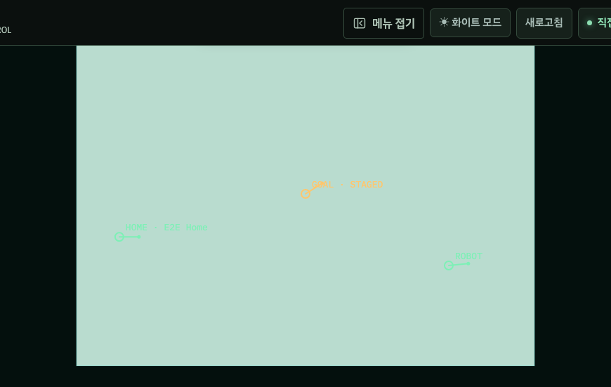
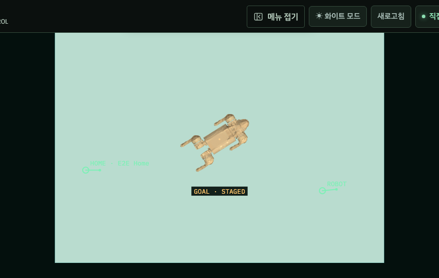
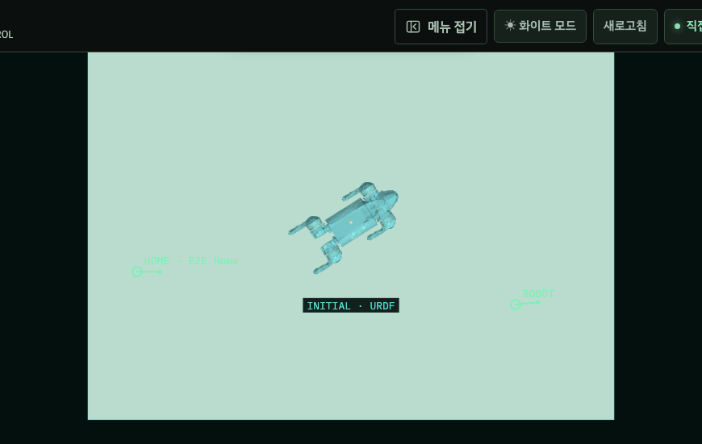
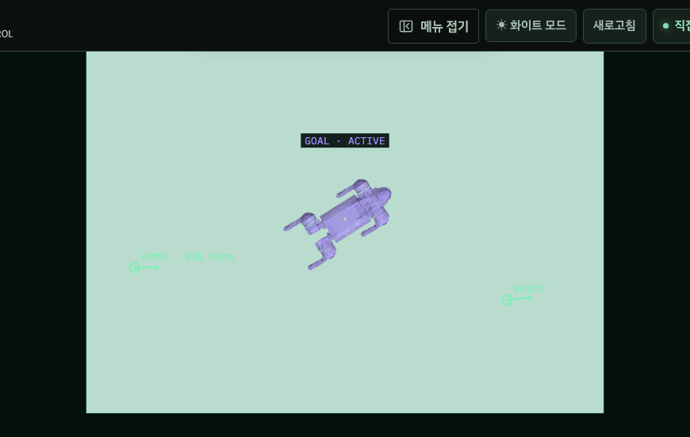

# Navigation Goal Pose URDF 미리보기

2026-10-29 KST. 기준 main `05960f87402b471a5c5636e73ee72c8a2cd83975`에서
Navigation 2D 지도 Canvas의 목표 표시만 수정했다. Initial Pose와 같은 공식 Go2
URDF 파생 메시를 목표 드래그 및 서버가 반환한 목표 위치·방향에 표시한다.
최종 방향 정렬 제어의 TF/progress 문제는 이번 작업에서 수정하지 않았다.

## 구현

- [navigation.js](../../robot_dashboard/static/navigation.js)의 `navigationPosePreview`는
  Initial/Goal 초안과 전송 목표가 같은 `drawRobotMapPreview()`를 호출하도록 한다.
  `worldToCanvas()`를 그대로 사용해 지도 origin yaw, 해상도, Y 반전과 Canvas 비율을 유지한다.
- [app.js](../../robot_dashboard/static/app.js)의 `drawNavigationMap()`은 기존
  `savedScene3d` 인스턴스에서 2D 주행 지도에 모델을 투영한다. 별도 3D 패널에만
  표시하는 변경이 아니다. 모델이 그려지면 큰 원/방향선 마커를 덧그리지 않는다.
  기존 마커 그리기 함수를 Navigation 모듈로 옮겼고 현재 로봇·주석의 기본 마커는 유지한다.
- [go2_official_model.js](../../robot_dashboard/static/go2_official_model.js)의 기존
  `drawRobotMapPreview()`와 `/static/assets/go2/go2-official-lite.json`을 재사용한다.
  메시·URDF·기본 관절값 재생성 및 새 렌더링 엔진 도입은 없다. 미터 scale=1이며
  live pose/관절값이나 해당 장면의 확대 scale을 목표 자세로 사용하지 않는다.
- Go2가 아닌 프로필, 다른/이전 asset, 미로딩/실패는 기존 원+방향선 fallback이다.
  모델 설정·로드 성공·실패 시 기존 지도 redraw를 예약한다. 기존 모델 generation과
  지도 load generation 검사를 유지한다. Canvas alpha는 save/restore로 격리한다.

| 표시 | 의미 | 색 |
| --- | --- | --- |
| ROBOT | 기존 실시간 현재 위치 마커 | 녹색 |
| INITIAL · URDF | 초기 위치 입력 초안 | 청록색 `#5dded8` |
| GOAL · STAGED | 예정된 정지 위치·방향 초안 | 주황색 `#ffc66d` |
| GOAL · SENT / ACTIVE | 서버가 반환한 전송/활성 목표 | 보라색 `#a28bff` |
| GOAL · CANCELING / CANCELED / SUCCEEDED / FAILED 등 | 서버의 실제 목표 상태 | 보라색과 해당 상태 라벨 |

목표 모델은 **계획된 정지 자세**다. 현재 실물 로봇·live 관절 또는 도착 완료를 뜻하지 않는다.
모델 라벨은 형상 바깥의 어두운 배경에 놓는다. 전송 목표는 위, 초안은 아래에 라벨을
배치하며 현재 로봇 마커를 마지막에 그려 중첩돼도 현재 위치가 가려지지 않게 한다.

## 지도 변경과 전송 조건

전송 목표 오버레이는 `goal.pose`와 유한한 X/Y/yaw, 해당 goal ID의
`precision_evidence.context.map_id/map_revision`을 요구한다. 이것이 현재 snapshot의
지도와 표시 중인 지도 ID/revision/frame에 모두 일치할 때만 그린다.
정보가 없거나 revision이 바뀌면 과거 목표를 새 지도에 투영하지 않는다.
이는 표시 조건이며 goal 허가·차단 조건에는 영향을 주지 않는다.

`can_send_goal`, `can_set_initial_pose`, FREE/UNKNOWN/OCCUPIED 클릭 검사,
명시적인 SEND 및 기존 현장 확인창, goal/initial-pose API payload, cancel/STOP,
제어 소유권, 지도 좌표 변환과 주행 파라미터는 변경하지 않았다.
드래그·모델 로드는 goal 전송을 발생시키지 않는다. 기존 사용자 CSS 수정 2개도 보존했다.

## 화면 비교

아래는 **합성 지도·모의 백엔드**를 사용한 실제 Chromium 화면이다. 실제 장비의
위치·주행 또는 성공 증거가 아니다. 수정 전 화면도 같은 fixture와 게시된 기준 SHA의
정적 코드를 브라우저에 로드해 캡처했다. 로컬에 있던 사용자 CSS는 전후 모두 보존했다.

| 수정 전 Goal | 수정 후 Goal 초안 |
| --- | --- |
|  |  |

| Initial Pose | 전송 후 Goal |
| --- | --- |
|  |  |

[초안/취소 목표 중첩](screenshots/navigation-urdf-overlap.png),
[390px·HiDPI·회전 지도·라이트 테마](screenshots/navigation-urdf-mobile-light.png),
[로드 중 fallback](screenshots/navigation-urdf-loading-fallback.png),
[로드 실패 fallback](screenshots/navigation-urdf-error-fallback.png).

## 검증

- Python 전체 3,116개 실행, 통과(기존 skip 3).
- JavaScript 전체 699개 통과. 새 5개 검사는 동일 투영/미터 비율, 원본 pose 보존,
  alpha 복구, 성공 시 중복 마커 생략, fallback, goal/map pin, 실제 공식 메시·기본 관절값,
  다른 프로필/이전 자산 거절을 검사한다.
- Playwright 51개 통과: `dashboard.spec.mjs`, `goal_precision.spec.mjs`,
  `navigation_goal_urdf.spec.mjs`. 최초 관련 7개 검사와 수정 전 코드의 별도 화면 캡처 1개도 통과했다.
- 실제 공식 asset으로 Initial/Goal XY·yaw 일치, 드래그만으로 mutation 0,
  확인창 취소 시 0·명시 확인 시 1, 원래 payload 유지, 서버 상태 라벨,
  지도 ID/revision 불일치 시 목표 숨김, 로딩 후 자동 URDF 전환을 확인했다.
- 1440px dark, 390px light/2× HiDPI, 비정사각형 지도/origin yaw=0.7,
  resize 후 pose 보존, 중첩 및 모델 실패 화면을 확인했다. 브라우저 확대는 별도
  실측하지 않았으며 화면 비율·미터 투영은 unit/HiDPI/resize로 검사했다.
- JS syntax, Ruff, 설정된 mypy 범위, secret scan, `git diff --check` 통과.
- 최초 전체 JS 검사는 app.js 길이 제한에서 1건 실패했다. 검사 한도를 바꾸지 않고
  마커 렌더 함수를 기존 Navigation 모듈로 이동한 뒤 전체 699개가 통과했다.

## 배포와 남은 범위

사용자가 이후 장비 접속을 허용했지만 이번 구현에 필요하지 않아 Jetson에 접속하지 않았다.
장비 배포, ROS 명령, Nav2 실행·주행, 설정 복원 또는 서비스 재시작은 수행하지 않았다.
이 변경의 장비 설치 SHA는 없다. 기존의 마지막 확인 배포 SHA는
`b15099cd8c40326b810e6c39a136f94944443cb9`이며 이번에 재조회하지 않았다.
원격 CI는 게시 커밋의 GitHub Actions 결과로 확인하며 로컬 검사와 구분한다.

`NAVIGATION_GOAL_URDF_UI_IMPLEMENTED` · `TESTED` · `DEVICE_NOT_RUN_CHARGING`

마지막 표기는 이번 UI 작업에서 장비 시험을 하지 않았다는 뜻이다. 사용자는 충전 중이라는
최초 설명 후 전원이 켜졌다고 알렸으며, 현재 충전 상태를 독립 계측하지 않았다.
