# C4 ROS owner handoff — 2026-10-30

Branch: `review/20261029-x-c4-runtime`. Started with clean local and remote
`7ac0d55b07abd20902d6d756c6b225733613fea7`. Existing implementation and independent
clone were retained. Latest task instructions authorize the new dedicated C4
hosted workflow; existing shared CI and D3 workflow/source are unchanged.

## Connection and ownership

```mermaid
flowchart LR
  ROS["Generated or replayed PointCloud2"] --> O["Existing single subscription owner<br/>PointCloudHub identity acceptance"]
  O --> H["ReviewRosPort.handoff<br/>original message and integer receipt"]
  H --> A["C4 AsyncRuntimeAdapter.offer_raw"]
  A --> W["Existing TrafficWorker<br/>1 executing + 1 latest pending"]
  W --> N["PointCloud2 normalization<br/>exact stamped transform"]
  N --> D2["Actual D2 process_lidar and Tracker"]
  D2 --> D3["Actual D3 assessment<br/>stationary advisory hypothesis"]
  D3 --> C4["C4 canonical conversion"]
  C4 --> C1["Actual C1 0.2<br/>whole-bundle acceptance"]
  C1 --> HTTP["Actual authenticated TCP HTTP"]
  HTTP --> C3["Actual current C3 parser and consumer"]
  C1 --> RAW["Accepted original raw PointCloud2<br/>marking only"]
  RAW --> CM["Isolated native Nav2 costmap"]
  CM --> P["Actual planner path readback"]
```

This is the implemented candidate topology. In the actual native execution,
identity acceptance stopped the ROS path; the core/HTTP path passed separately
with fixture transport. The outcome table below is authoritative.

`AsyncRuntimeAdapter` creates no ROS subscription. The owner calls handoff after
`PointCloudHub.process` identity acceptance, including viewport-throttled inputs,
with `raw_context_snapshot()` and its original integer monotonic receipt. The
native harness has one generated-input owner subscription; it never calls
`ReviewRosPort.start`. Production pointcloud, worker, navigation and control
owners remain untouched. Heavy normalization and D2/D3 execution stay in the
existing worker thread. D2 precedes D3; no Dots work was launched or reordered.

Original source stamp, receipt, source/clock/TF epoch, map revision/generation,
raw frame/layout/bytes and owner evidence survive the handoff. Graph-only source
identity is labelled as graph evidence, without inventing per-message GID or
promoting ROS_HEADER_UNVERIFIED into a known source clock. An independent
ClockMapping is required. Decimal ns and TTL remain the C1 0.2 values.

`rebind` advances both runtime and map generation for every reset. C1 scene and
source invalidation are immediate; Runtime.rebind runs serially before the next
worker item. Queued old inputs are removed; an old running result cannot commit
or publish. C1 accepts the entire candidate obstacle/assessment bundle in a
same-policy trial service before either exclusive live slot changes. D2 object
budget rejection and oversized C1 output leave no partial successful frame.

The native publisher is separately pinned to the initial context: a C1 reset
alone cannot reset a costmap. New-generation core/C1 processing continues, while
native publication is rejected with NATIVE_CONTEXT_RESET_REQUIRED until the
integration owner independently resets the native session. Empty/stale input
never produces free rays or CLEAR. No D2 box is converted to a clearing ray.

## Public C4 entrypoints

| File | Interface |
|---|---|
| `robot_dashboard/expansion_runtime/async_adapter.py` | `Capture`; `AsyncRuntimeAdapter(runtime, capture_provider, scene_factory, config, source_id, clock_ns, observation_sink)`; `start`, `offer_raw`, `rebind`, `health`, async `close`; read-only `scene` facade for actual C1 router |
| `robot_dashboard/expansion_runtime/owner_identity.py` | `from_owner(message, observation, context, source_id, sequence, receipt_ns, clock_domain, evidence_kind)` |
| `robot_dashboard/expansion_runtime/marking_ros.py` | `MarkingRosPublisher(existing_review_node, context_provider, clock_ns)`; callable accepted-completion sink |
| `experiments/expansion_20261029/c4_runtime/ros_bridge/dependencies.py` | exact-SHA read-only exporter/loader; checks used native files and common packages |
| `experiments/expansion_20261029/c4_runtime/ros_bridge/native_ci.py` | GitHub-hosted-only driver, immutable D3 base image, inspected network-none container, retained success/failure artifacts |
| `experiments/expansion_20261029/c4_runtime/ros_bridge/native_probe.py` | real ROS input, lifecycle, parameter, costmap and planning readback; no controller or actuator |
| `experiments/expansion_20261029/c4_runtime/ros_bridge/http_probe.py`, `consumer_check.mjs` | actual authenticated uvicorn TCP response and exact-byte latest C3 execution |

The service factory must return a new, empty, exclusive C1 0.2 service with the
same limits/clock policy. Other writers must not mutate this instance. Its C1
router reads `adapter.scene`; no product router is mounted by this candidate.
The observation mode remains **ADVISORY_ONLY**; new URDF protection is not active.

## Exact executed dependencies

| Role | SHA | Actual use |
|---|---|---|
| C1 | `e0bc9cf8ba8bd22b406a287e1a9ef867a0cd367b` | 0.2 contracts, time normalization, SceneSnapshotService, HTTP router |
| C3 | `e394b090221c555cf0649021d132163596c19fe2` | current 0.2 byte parser, adapter and consumer |
| D2 | `7313f0a31c00ae87ae216b84ca41a23804e91917` | process_lidar, Tracker, provenance compactor |
| D3 | `356d0a036eb62d546e159e12a0691d7f5ea278f6` | geometry/assessment plus read-only native image builder/config generator |

Peer source is fetched by exact SHA, exported outside the checkout and made
non-writable. Blob hashes are checked before and after execution. D3's native
experiment and the original candidate YAML are also verified. No owner branch
was merged, cherry-picked, edited or copied into the submission. C2 stays frozen;
this input path does not use C2 or D1. Existing older-pin regression profiles
remain separate subprocesses. D3 ROUND2_RESULTS and C1's latest
CURRENT_COMPOSITION_20261030 were read before extending this connection.

## Executed evidence

Local full suite: **3151 tests, OK, 6 skips** (102.023 s), including the new 12
actual-core/async/TCP-HTTP cases and the unchanged historical 20 + 15 profiles.
Those 12 use fixture transports with real D2/D3/C1; they are not ROS tests.
Worker scheduling fault injection proves 1 executing + 1 pending, 39 replacements
from a 40-input burst, and one actual worker thread. Rebind while busy, late and
duplicate input, clock/source/header mismatch, close while busy, 72-object D2
rejection and C1 oversize whole-frame rejection are covered without larger limits.

JavaScript: **77 test files PASS**, syntax **112 modules PASS**. Repository CI's
Ruff scope (`robot_dashboard scripts`), tracked-source secret scan and diff check
PASS. A broader ad-hoc `ruff check .` reports 2295 repository-wide style/unused
import findings outside that established scope; no lint config was changed.

Actual local TCP HTTP: unauthenticated 401, authorized 200; unchanged 0.2 bytes
pass the latest C3 parser/consumer. Original receipt ns above `2**53` and expiry are retained.
Missing C1 pose/joint slots produce collision drawable UNAVAILABLE with
POSE_JOINT_OR_SOURCE_INSUFFICIENT. This is JS consumer execution, not a browser
rendering claim. The older C3 0.2 failure in FOLLOWUP is preserved as history.

## Actual hosted native outcome: FAIL at owner identity

Native runtime SHA: **`652b9bfff72e29d35447661c0d3deaebe5044331`**.
The containing delivery commit adds the observed-rejection/large-ns regressions
and this report; native runtime/adapter code is byte-identical to that SHA.
[ROS_EVIDENCE.json](ROS_EVIDENCE.json) records hashes, exact observed owner
context, aggregated errors, image IDs, mount isolation and failure history.

[Native run 41033864595](https://github.com/Phjrab/robot-scope-ros2-dashboard/actions/runs/41033864595)
**FAIL**, container exit 1. Its
[artifact 12967890428](https://github.com/Phjrab/robot-scope-ros2-dashboard/actions/runs/41033864595/artifacts/12967890428)
contains the actual planner log, effective YAML/readback, D3 package/image lock,
container receipt and failure summary (14-day GitHub retention). No success
receipt or reduced acceptance criterion replaces this failure.

| Segment | Result | Observed evidence |
|---|---|---|
| UNIT / async scheduling and rejection | PASS | 12 new actual-core/fixture cases; unknown graph is explicitly rejected |
| Actual D2 → D3 → canonical C1 | PASS with fixture transport | Local and hosted Python processes; no mock algorithms |
| Actual C1 TCP HTTP → current C3 | PASS | 401 then 200, unchanged 0.2 bytes, decimal ns above 2**53, expiry; no browser-render claim |
| Actual ROS PointCloud2 transport | PASS to owner callback | Native DDS messages reached PointCloudHub in network-none container |
| Existing source/observation identity acceptance | **FAIL** | OWNER_SOURCE_IDENTITY_UNAVAILABLE; 0 accepted inputs, 0 raw publications |
| Actual ROS → Runtime → C1 chain | NOT_RUN beyond rejected owner | Offline/core success is not substituted |
| Native Nav2 lifecycle / parameters | PASS | Configure and activate succeeded, state 3; actual 250×250 costmap; 0.04 m resolution, original footprint, marking=true, clearing=false, expected update 0.3 s |
| Native costmap marking | NOT_RUN | No identity-qualified input reached the publisher |
| Native costmap clearing | NOT_RUN / NOT_PROVEN | No original free-ray evidence; no box-derived clearing |
| Native planner reaction | NOT_RUN | ComputePathToPose cases were not reached |
| Native sensor loss / epoch / late-input cases | NOT_RUN | Code is prepared, native execution stopped earlier; UNIT equivalents pass |
| Simulated actuator | NOT_RUN | Pinned D3 runner lacks C4 ingress hook; C4 probe starts no controller/actuator |
| Device | DEVICE_NOT_RUN | No device or production connection |

The exact observed graph had one endpoint and an actual endpoint GID, but its
QoS history was `UNKNOWN`, depth 0. Existing owner graph validation therefore
returned GRAPH_ENDPOINT_CONTRACT_UNAVAILABLE. The D3 Humble metadata executor
was also used read-only; its native metadata did not give this owner an accepted
per-message publisher identity (`publisher_gid=null`, identity UNAVAILABLE).
The adapter rejected it before worker submission. An endpoint GID is not relabelled
a message GID, UNKNOWN history is not replaced with a desired setting, and no
owner source or safety criterion was modified. The new UNIT regression preserves
this refusal, without counting that expected rejection as native success.

Isolation was actually inspected: Docker network **none**, ROS localhost only,
domain **194**, namespace `/robot_scope_review_x`, read-only `/repo` and `/deps`,
only `/results` writable, no devices, dropped capabilities and no-new-privileges.
The container was removed. Humble Nav2 planner/costmap were **1.1.20**. The C4
transport overlay changed source routing/type and host-clock mode; D3 original
source/config/footprint/inflation/planner were preserved. Effective 0.3 s staleness
was not relaxed to make an input-dead costmap pass.

First failures are preserved:

1. [41031221158](https://github.com/Phjrab/robot-scope-ros2-dashboard/actions/runs/41031221158): workflow validation, no native job; fixed C4 job environment context.
2. [41032206834](https://github.com/Phjrab/robot-scope-ros2-dashboard/actions/runs/41032206834): D3 image built, C4 overlay could not resolve bare local image ID; fixed exact-ID-verified local tag.
3. [41032870281](https://github.com/Phjrab/robot-scope-ros2-dashboard/actions/runs/41032870281): actual lifecycle/parameter readback passed; first marking-input timeout.
4. [41033864595](https://github.com/Phjrab/robot-scope-ros2-dashboard/actions/runs/41033864595): same rejection with actual D3 metadata executor and complete owner/worker diagnostic evidence.

Existing full CI for initial implementation `ddf2ce1` completed
[SUCCESS 41031223156](https://github.com/Phjrab/robot-scope-ros2-dashboard/actions/runs/41031223156),
including both Python environments and hardware-free browser E2E. This does not
make the separate native workflow green. Final delivery HEAD and both final CI
run outcomes are reported in the delivery message, without embedding a
self-referential commit SHA here.

## Delivery-source CI audit

Actual final implementation/test SHA **`92c36c3d7a7dd87385ae71316dbb2d9059f77d67`**
was pushed and checked. The containing audit commit changes only this report and
its JSON evidence; final publication HEAD is reported in the delivery message.

- [Native run 41035596751](https://github.com/Phjrab/robot-scope-ros2-dashboard/actions/runs/41035596751): **FAIL**, same owner identity rejection after 62 actual callbacks, 0 delivered / 0 published. All **12** actual-owner Python checks passed first. [Final native artifact](https://github.com/Phjrab/robot-scope-ros2-dashboard/actions/runs/41035596751/artifacts/12967872693) is retained with digest in ROS_EVIDENCE.json.
- [Full CI 41035596779](https://github.com/Phjrab/robot-scope-ros2-dashboard/actions/runs/41035596779): **FAIL**. Ubuntu 22.04/Python 3.10 and competition-offline-integration succeeded. Ubuntu 24.04/Python 3.12 passed Python/JS/static/audit checks, then had **226 browser tests pass / 1 fail**; its subsequent mission API fixture step was not run.
- The first full-CI error is `tests/e2e/mount_calibration.spec.mjs:343`, “imports saved SYNTHETIC artifacts ... exports relative-only input”. At line 378, `page.waitForEvent('download')` encountered the **overall 20,000 ms test deadline**. The event's own configured timeout is 5,000 ms; neither limit was changed. [Browser failure artifact](https://github.com/Phjrab/robot-scope-ros2-dashboard/actions/runs/41035596779/artifacts/12969460451) includes the screenshot/trace/error context and is retained locally outside Git.
- Baseline comparison: the prior source `652b9bf` completed [full CI 41033864515 SUCCESS](https://github.com/Phjrab/robot-scope-ros2-dashboard/actions/runs/41033864515); the same final `92c36c3` passed this browser test in Ubuntu 22.04. Browser source, E2E fixtures/test, package lock, Playwright config and shared CI are byte-identical to the starting `7ac0d55` in Git. This narrows the evidence but does **not** prove a root cause or erase the Ubuntu 24.04 failure.

No retry-to-green, timeout increase, deleted test or unrelated owner-code fix was
used. This UI download timeout remains a separate observed CI failure for its
owner to investigate; it does not substitute for the native identity contract.
A subsequent docs-only CI result, if available, is reported separately in chat.

## Reproduction and next boundary

See the [executable recipe and host example](../../../experiments/expansion_20261029/c4_runtime/ros_bridge/README.md).
The C4 workflow is `.github/workflows/c4-ros-isolated.yml`, triggered only by C4
source/test/harness changes on this review branch. Local ROS/Docker are absent;
native evidence comes only from the actual hosted container run, not a mock.

The remaining integration item is an explicit, actually accepted C4 owner-ingress/
reset contract for D3’s native scenarios. First the input owner/integration owner
must provide genuine per-message identity or a reviewed, accurately labelled
Humble graph-evidence contract; C4 cannot weaken or edit that owner here. That
same entrypoint must retain reset and original free-ray evidence and expose the
existing virtual actuator for the remaining scenarios. At the pinned D3 SHA, the public
runner has no such ingress hook. D3's historical five-case actuator results are
not relabelled as C4 end-to-end results. C4 provides original accepted samples and
a generation fence; D3 retains controller, collision algorithm and native config
ownership. No replacement simulator or controller was implemented here.

No real robot/device connection, production ROS graph, main integration, shared
product hook, deployment, real goal/cmd_vel, lease/arbiter/STOP/estop or heading
change occurred. **DEVICE_NOT_RUN** throughout.
